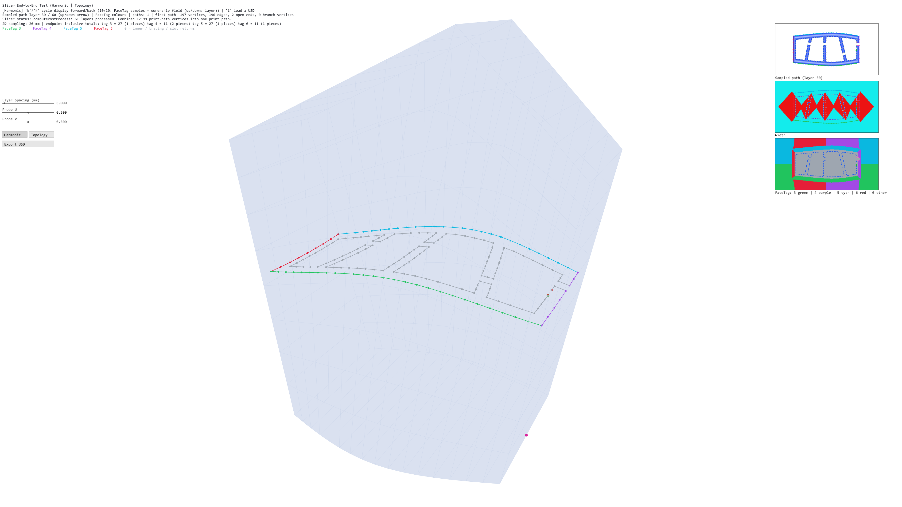
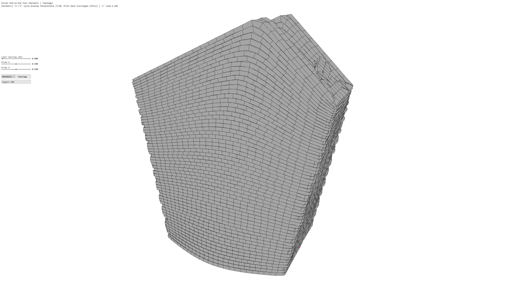
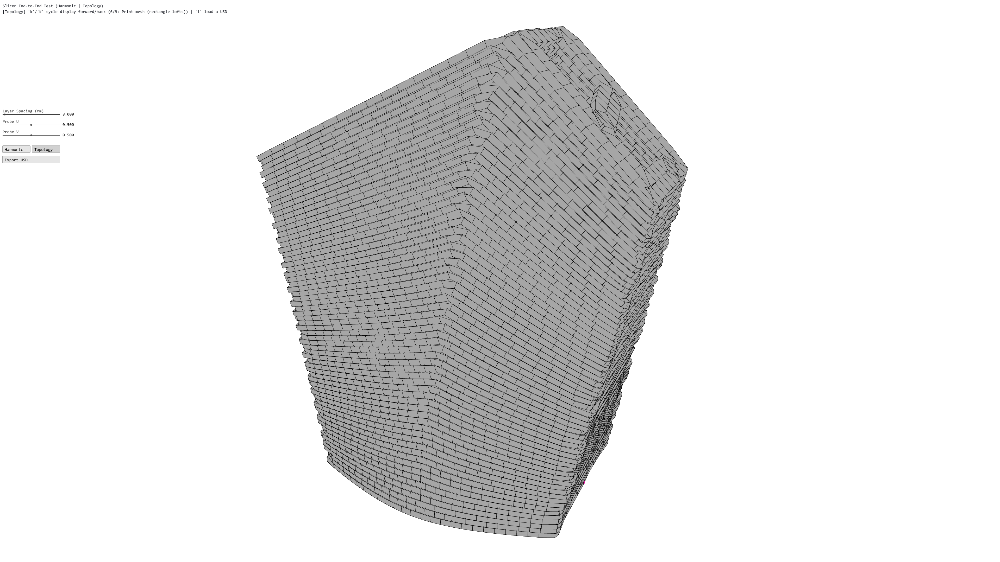

# FaceTag sampling in the main slicer

Verified 27 October 2026 using `example_facetags_3-6.usda` from the shared assets.
The topology and harmonic slicers now preserve the original side FaceTag on
outer print targets and use a fixed point budget for each tag across printable
layers. The staggered slot's two outer pieces share one budget.

## Run and inspect

From this repository root, launch the verified runtime:

```bat
alice2\run_with_zspace.bat build_surface_height
```

The optional build-directory argument selects the executable and its matching
DLLs, and sets their directory as the working directory for saved cameras.
The launcher's default remains `build_zspace_v3`.

Load the shared USD with `i`, then choose Topology or Harmonic. `k` cycles
forward and `K` backward. The additional last view is **FaceTag samples +
ownership field**: topology 9/9, harmonic 10/10. Up/down changes the inspected
printable layer. The fixed top reference section is excluded from this count.

- 3: green; 4: purple; 5: cyan; 6: red.
- Gray: inner paths, bracing and slot returns.
- The HUD shows the target 2D distance, endpoint-inclusive counts and number of
  pieces for each tag.
- The right-hand panels show the path field, width field and categorical
  FaceTag ownership. Tagged target dots and edges use the same palette.
- The existing Print Mesh view remains topology 6/9 and harmonic 7/10.

Known limitation: switching inspected layers is currently slow, particularly
when the FaceTag ownership field is first generated for a layer. Layer-switching
performance remains follow-up work.



## Sampling rule

Lengths are measured in the flattened 2D chart. For each side tag, sum the
printable lengths of its outer pieces on each layer, then average across the
printable layers. The rounded average length divided by `ResampleLength` gives
the target interval budget. Open-piece endpoints and protected geometric
features establish the minimum point budget. Each layer uses the same total.

On a slotted side, interval allocation is proportional to that layer's piece
lengths, with at least one interval per protected span. Both slot endpoints stay
in the path. Counts on individual pieces can change as the slot shifts, while
their total stays fixed. Spacing is uniform between protected anchors; rounding
and layer-length variation mean the achieved distance can differ from the target.

For this input at 20 mm:

| Main slicer | Printable layers | Tag 3 | Tag 4 | Tag 5 | Tag 6 |
| --- | ---: | ---: | ---: | ---: | ---: |
| Topology | 65 | 28 | 11, two pieces | 28 | 11 |
| Harmonic | 61 | 27 | 11, two pieces | 27 | 11 |

These are segment-membership counts including endpoints. Shared wall corners
are stored once in the graph and belong to both incident segments. Their single
per-point label uses the smaller incident tag, so per-point-label counts differ
from endpoint-inclusive segment counts.

The even/odd topology captures retain the same totals around the staggered slot:


## Implementation

Face tags 1/2 retain their bottom/top meanings. Values 3–6 are side regions,
independent of bead-width IDs. Topology transfers their identity through wall
columns. Harmonic slicing preserves `(width ID, FaceTag)` through TetGen and
relaxation, then decodes physical width IDs before generating the fields.

The shape and width fields retain their existing construction. A shared
continuous distance-field query identifies the active wall/inner/bracing/slot
branch and the wall region. Integer IDs are never interpolated. The same query
drives the new ownership panel and contour labels.

For distinguished side tags, PrintSyn prepares corners and orientation, aligns
and cuts the seam, inserts category anchors, normalizes projected-coincident
anchors, assigns the cross-layer budgets, samples in 2D, projects to 3D and
links the layers. This policy uses the requested 2D budget rather than a later
3D resampling pass that would change the counts. Legacy inputs containing only
side tag 3 retain the existing 3D target-sampling workflow and controls.

Per-point normals and heights still come from the section projection. Existing
height scheduling and validation remain active. These main-runtime captures
use the input's `[6, 12]` mm height domain, the existing 0.05 mm fabrication
tolerance and eight relaxation iterations. The selected build retains global
height scheduling with local surface correction disabled, as before this change.

`PrintPath` exposes `faceTags`, `edgeFaceTags` and `faceTagSegments`. The latter
records ordered segment membership. Labels survive projection and linking;
travel edges use 0. The maintained Toolsets WASM result uses slot 6 for point
FaceTags, Python exposes the arrays, and USD export authors
`/TDP_gcode.printFaceTags`. A 0 label also represents unavailable region metadata
in legacy inputs. `trackIds` retains its original inner/outer meaning.

The main desktop runtime uses the existing backend checkout at
`zspace_toolsets/build/worktrees/task-008-print-path-post-processing`. The feature
is also implemented in the maintained toolsets checkout. The desktop backend's
feature masks, height controls and top-reference convention are retained.

The desktop backend implementation is committed on
`codex/task-008-print-path-post-processing` at `fbea28a4`; the maintained
toolsets implementation is on `slicer` at `83102de2`. The companion webviewer
FaceTag inspector is on `feature/wasm-slicing` at `7d867c2`.

## Print-mesh repair

The harmonic mesh initially failed with `Zero or invalid section direction`.
Some different 2D anchors mapped to the same float-valued 3D position. Consecutive
projected-coincident anchors now share one physical anchor, retaining their
combined feature identities. This happens **before** calculating the common
budget, so the repair does not remove targets from individual layers afterward.

Both main Print Mesh views now generate and render successfully:





## Verification and evidence

- Main Alice2 build and 22 native correctness tests passed, including the new
  cross-layer budget, per-point alignment, feature-mask and field-parity checks.
- Maintained toolsets native build and eight correctness tests passed.
- The actual shared USD was exercised through native slicing and the maintained
  WASM import/compute/export path. Exported per-point FaceTags retain their order.
- Both main slicers produced complete paths and print meshes using the authored
  input settings and the existing desktop height profile.
- Each final PNG is a native 3840×2160 saved-F1 render with 1× UI. The full images
  were inspected; no resizing or post-processing was used for the delivered files.
- Camera hashes before/after capture match. Adjacent `.capture.json` files record
  the input hash, settings, executable/DLL identities, camera hash and source PNG.
- Input SHA-256:
  `814235bf11b0127051f5c752aee4fa3fbdf5db9694c09f09ab527e00408cead0`.

Captures follow the shared `skills/alice2-screenshot/SKILL.md` workflow. The
helper at `alice2/scripts/capture-face-tags.ps1` launches a bounded,
separate instance, preserves the camera file and refuses to overwrite evidence.
For another capture, supply a fresh suffix:

```powershell
& .\alice2\scripts\capture-face-tags.ps1 -Mode harmonic -Layer 30 -Suffix repeat
& .\alice2\scripts\capture-face-tags.ps1 -Mode harmonic -View printmesh -Suffix repeat
```

Build the selected desktop backend with the existing `build_with_zspace.bat`
workflow, specifying `-BuildDir alice2/build_surface_height`,
`-ToolsetsDir ../zspace_toolsets/build/worktrees/task-008-print-path-post-processing`
and `-Test`. Preserve the configured native OpenUSD and TetGen paths.

The packaged webviewer JS/WASM pair was not refreshed by this native-workflow
integration.
